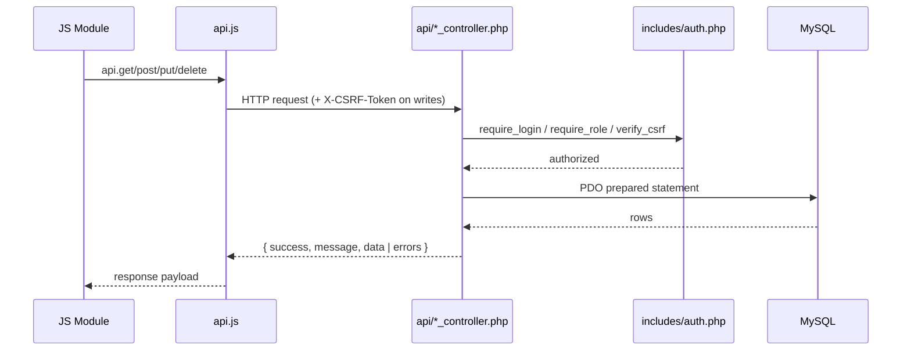
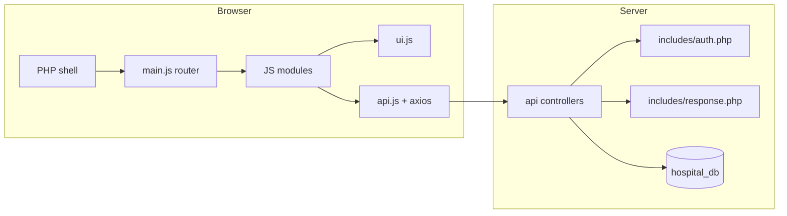

# Architecture

No framework and no build step. The app is a classic PHP page shell hosting a client-side SPA that talks to JSON controllers.

## Layers
1. **Page shells** (`admin_dashboard.php`, `doctor_dashboard.php`, `receptionist_dashboard.php`, `login.php`) — enforce session/role with `require_role()` before any output, then render the layout.
2. **SPA router** — `assets/js/main.js`. Hash-based routes (`#patients`, `#users`, …), a `modules` registry, sidebar state, and off-canvas behaviour.
3. **Feature modules** — `assets/js/modules/*.js`. Every module exports `{ state, init(container) }`; `init` renders its own view into `#module-viewport`.
4. **UI toolkit** — `assets/js/ui.js` (toasts, focus-trapped modals, confirm dialogs, `escapeHtml`) and `assets/js/api.js` (Axios instance, CSRF header injection, 401 → login redirect).
5. **API controllers** — `api/*_controller.php`. Each controller: connects via `config/db_connect.php`, calls `require_login()` / `require_role()`, verifies CSRF on writes, then dispatches on HTTP method.
6. **Database** — MySQL via PDO. Soft-delete convention and junction tables; see [[Database Schema]].

## Request lifecycle


## Module flow


## Folder map
```text
api/                     JSON controllers
assets/css/style.css     Design system + responsive rules
assets/js/api.js         Axios wrapper (CSRF, 401 handling)
assets/js/main.js        SPA router + sidebar
assets/js/ui.js          Toasts, modals, escapeHtml
assets/js/modules/       Feature modules (see links)
config/db_connect.php    PDO connection
includes/auth.php        Session, CSRF, RBAC, throttling
includes/response.php    send_success / send_error / get_json_input
migrations/hospital_db.sql
tests/                   PHP verification scripts
```

## Conventions
- Module contract: `init(container)` renders structure, binds events, then loads data.
- Numeric responses use `send_success(message, data, status)` / `send_error(message, errors, status)`.
- Validation errors are keyed by field (e.g. `specialty_id`) so the UI can map them to inputs.
- Cache-busting: shell assets use `?v=N`, and ES-module imports carry the same `?v=N`.
