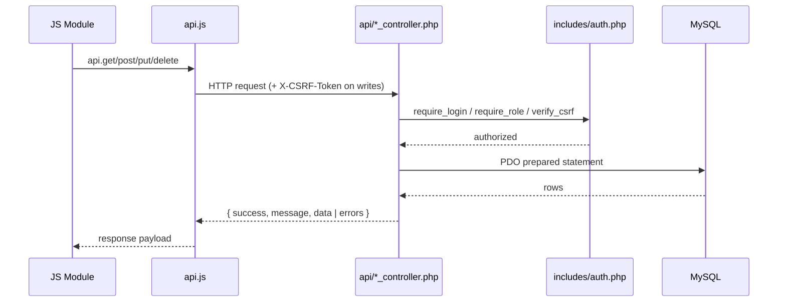
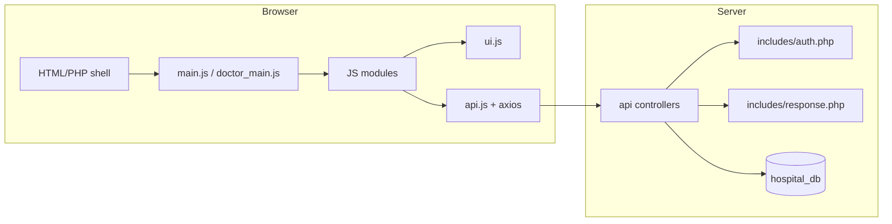

# Architecture

The system is built without heavy external frameworks or complex build tools. Each portal loads a single HTML/PHP page shell and runs as a **Single-Page Application (SPA)**—meaning the browser stays on one page while JavaScript smoothly swaps screens and exchanges **JSON** data (a lightweight, structured text format) with PHP scripts on the server.

## Layers
1. **Page shells & session guard** (`admin_dashboard.html`, `doctor_dashboard.html`, `receptionist_dashboard.html`, `login.html`, plus `assets/js/session-guard.js`) — Before showing any dashboard screen, `session-guard.js` asks `api/auth_controller.php?action=me` (`requireSession()`) whether the visitor is signed in and has the right role. On the server side, every PHP controller also runs `require_login()` and `require_role()` so data stays protected even if someone calls an API URL directly.
2. **SPA routers** — `assets/js/main.js` (Administrator portal) and `assets/js/doctor_main.js` (Doctor portal). These scripts watch the `#hash` part of the browser address bar (such as `#patients`, `#doctor_appointments`, or `#doctor_consultation/1` where `1` is the appointment ID), highlight the active menu item in the sidebar, load the matching screen module, and control the slide-out menu on mobile screens.
3. **Feature modules** — `assets/js/modules/*.js`. Each screen is a self-contained JavaScript file that exports `{ state, init(container, param) }`. When you switch screens, the router calls `init` to draw that screen inside the `#module-viewport` area of the page.
4. **UI toolkit & API helper** — `assets/js/ui.js` provides shared building blocks used by every screen: HTML/currency helpers (`create`, `gId`, `formatCurrency`), pop-up notifications (**toasts**), pop-up dialog boxes (**modals**) that keep keyboard focus inside the box, confirmation prompts, and `escapeHtml` (which turns special characters into safe text). `assets/js/api.js` wraps **Axios** (an HTTP request library) to automatically attach the user's **CSRF security token** on save/delete requests, unwrap server responses, and send the user back to the login page if their session expires (`401`).
5. **API controllers** — `api/*_controller.php`. Each PHP controller connects to the database via `config/db_connect.php`, checks that the user is logged in with the right role (`require_login()` / `require_role()`), verifies the security token on data changes (`verify_csrf_on_state_change()`), and runs the requested action based on the HTTP method (`GET` to read, `POST` to create, `PUT` to update, `DELETE` to remove).
6. **Database** — MySQL accessed through **PDO** (PHP Data Objects). Uses soft-delete timestamps (`deleted_at`), linking tables (**junction tables**), and all-or-nothing **database transactions** for clinical encounters; see [[Database Schema]].

## Request lifecycle
This diagram shows what happens step-by-step when you click a button or load a table in the browser:



## Module flow
This diagram shows how the browser files connect to the server files:



## Folder map
```text
api/                     Server-side PHP controllers (master files + doctor clinical endpoints)
assets/css/style.css     Visual design system + mobile/tablet layout rules
assets/js/api.js         Axios network helper (attaches CSRF tokens, handles expired logins)
assets/js/main.js        Administrator SPA router + sidebar navigation
assets/js/doctor_main.js Doctor SPA router (supports #module/param routes) + sidebar
assets/js/session-guard.js Browser-side login & role checker
assets/js/ui.js          DOM/currency helpers (create, gId, formatCurrency), toasts, modals, escapeHtml
assets/js/modules/       Individual screen modules (Admin & Doctor portals)
config/db_connect.php    PDO database connection setup
includes/auth.php        Session checks, CSRF protection, role checks, login rate-limiting
includes/response.php    Standard JSON reply helpers (send_success / send_error / get_json_input)
migrations/hospital_db.sql Full SQL database structure and sample data
tests/                   Automated PHP verification scripts
```

## Conventions & ITE 387 Lesson Alignment
- **ES Modules & Helper Aliases (`01 JavaScript Foundations`):** Screen modules export `{ state, init(container, param) }`, wait for the page to finish loading (`DOMContentLoaded`), use small **factory functions** to create blank form row objects, process lists with `.filter()`, `.map()`, and `.forEach()`, and share helper functions (`create`, `gId`, `formatCurrency`) from `assets/js/ui.js`.
- **DOM & Styling (`02 DOM and UI`):** Dynamic rows are built using the *Create → Configure → Listen → Append* pattern (`create()`, template strings, and row-scoped `row.querySelector()`), while visual states are switched by adding or removing CSS classes (`classList.add()` / `classList.remove()`).
- **APIs & PDO Transactions (`03 APIs and Database Operations`):** Server replies use `send_success(string $message, $data, int $statusCode)` and `send_error(string $message, array $errors, int $statusCode)`. Because `send_success` converts `$data` into a JSON object (`(object)$data`), list endpoints return arrays inside `['items' => $rows]` and the browser reads `res.data.items`. Actions that save across multiple tables at once (such as [[Doctor Consultation]] and [[Manage Doctors]]) use **PDO database transactions** (`beginTransaction()`, `lastInsertId()`, `commit()`, `rollBack()`) so partial data is never saved if an error occurs.
- **Normalization & Master-Detail (`04 Database Design`):** Database tables are organized in **Third Normal Form (3NF)** (separating login accounts in `users` from clinical details in `doctors` to avoid duplicate data), use a **junction table** (`doctor_specialty`) for many-to-many links, and use **Master-Detail foreign keys** where one `consultation` header links to many `diagnosis`, `prescriptions`, and `lab_requests` rows.
- **Cache-busting:** Page shells and JavaScript module imports include `?v=22` at the end of file URLs so the browser always loads the newest version after an update.
