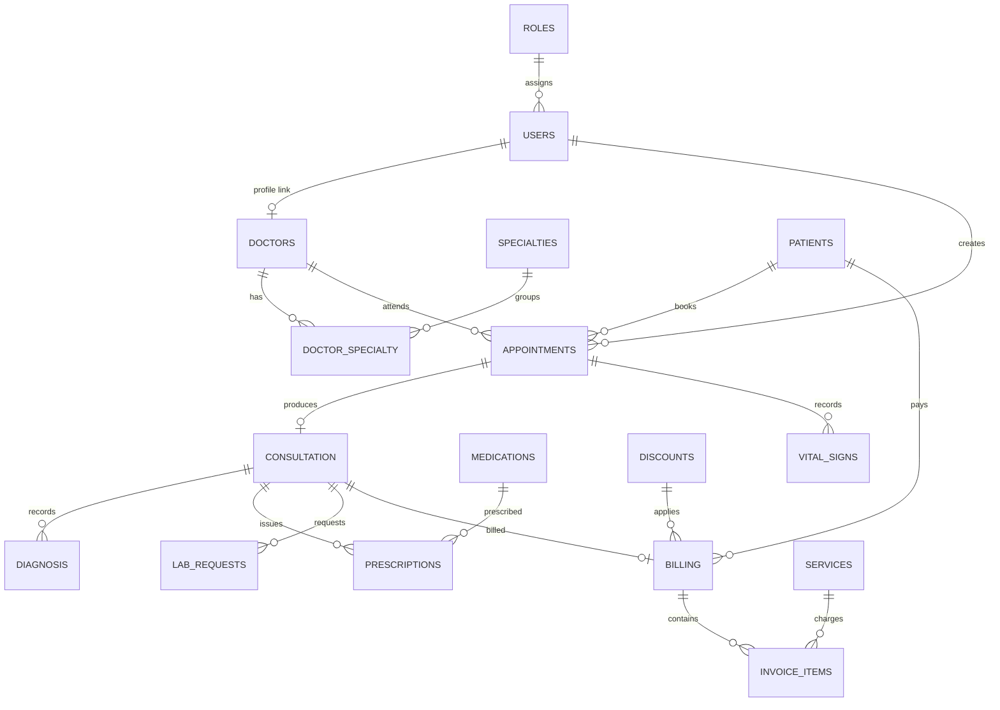

# Database Schema

Database: `hospital_db` (utf8mb4 / utf8mb4_unicode_ci). Full dump: `migrations/hospital_db.sql`.

## Conventions
- Every master table has `created_at`, `updated_at`, and `deleted_at`. `deleted_at IS NULL` means active; non-null means archived (soft delete).
- `roles` is a lookup table: Administrator, Receptionist, Doctor, Cashier.
- `doctor_specialty` is a junction table so one doctor can have **many** specialties.
- Personal identity data (`first_name`, `last_name`, `middle_initial`, `gender`) is stored **only** on `users`. `doctors` holds doctor-specific data and links to the account via `user_id` (no name duplication).

## Core relationships

## Tables
### Access control
| Table | Key columns | Notes |
| --- | --- | --- |
| `roles` | `role_id`, `role_name` (unique) | Seeded: Administrator, Receptionist, Doctor, Cashier |
| `users` | `user_id`, `role_id` → roles, `username` (unique), `password_hash`, `first_name`, `last_name`, `middle_initial`, `gender` (VARCHAR 50), `deleted_at` | Bcrypt hashes; gender supports custom values |

### Master files
| Table | Key columns | Notes |
| --- | --- | --- |
| `patients` | `patient_id`, `first_name`, `middle_initial`, `last_name`, `gender` (VARCHAR 50), `date_of_birth`, `contact_no`, `address`, `deleted_at` | `gender` defaults to `'unknown'`; supports custom values |
| `doctors` | `doctor_id`, `user_id` → users (unique), `contact_no`, `deleted_at` | Profile-only table: names/gender live on `users` (single source of truth, 1:0..1 link) |
| `specialties` | `specialty_id`, `specialty_name` (unique), `deleted_at` | |
| `doctor_specialty` | `doctor_id` + `specialty_id` (composite PK) | Many-to-many |
| `services` | `service_id`, `service_name` (unique), `price`, `deleted_at` | |
| `discounts` | `discount_id`, `discount_name` (unique), `percentage`, `deleted_at` | |

### Transactions (schema present, UI planned — see [[Roadmap]])
`appointments`, `consultation`, `diagnosis`, `lab_requests`, `prescriptions`, `billing`, `invoice_items`, `vital_signs`.

## Soft-delete / restore / hard-delete
All master-file controllers expose the same actions:
1. `soft_delete` — sets `deleted_at = NOW()`; record appears in [[Manage Archive]].
2. `restore` — sets `deleted_at = NULL`.
3. `hard_delete` — removes the row; foreign keys can block this when transactions reference it (surfaced as a 409 error).
