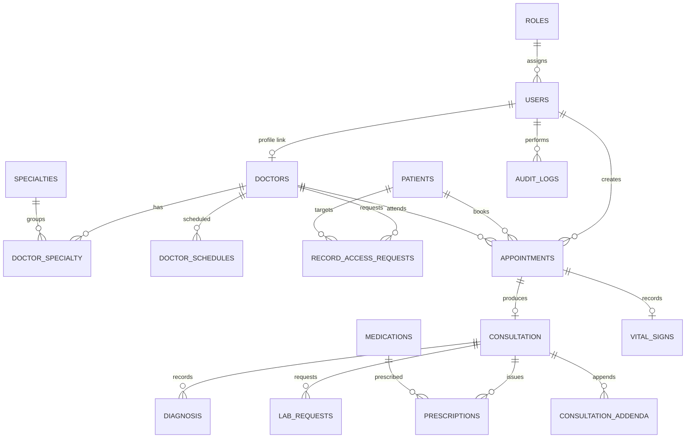

# Database Schema

The system uses a MySQL / MariaDB database named `hospital_db` (configured with `utf8mb4` / `utf8mb4_unicode_ci` so international characters and symbols are stored cleanly). The full database structure and starter data are saved in `setup/schema.sql` and `setup/seeds.sql`.

## Conventions
- **Timestamps & Soft Deletes:** Every core record table (**Master File**) includes `created_at` (when the record was made), `updated_at` (when it was last changed), and `deleted_at` (when it was archived). When `deleted_at IS NULL` (empty), the record is **active**. When `deleted_at` has a date and time, the record is **archived (soft-deleted)**. Archived records are hidden from active operational lists, though historical views (like [[Doctor Patient Records]]) may display them with an Archived badge to preserve medical context.
- **Role Lookup Table:** `roles` stores the staff job titles: `Administrator`, `Receptionist`, and `Doctor`.
- **Many-to-Many Specialties (`doctor_specialty`):** Because one doctor can practice multiple specialties and one specialty can belong to multiple doctors, the `doctor_specialty` **junction table** (linking table) pairs `doctor_id` with `specialty_id`.
- **Normalized Doctor Identity:** Personal identity fields (`first_name`, `last_name`, `middle_initial`, `gender`) live exclusively on `users`. The `doctors` table only stores doctor-specific data (`contact_no`) and links to `users` via `user_id`.

## Core relationships
The **Entity-Relationship Diagram (ERD)** below shows how the database tables connect to one another:

## Tables
### Access control & audit
| Table | Key columns | Notes (Plain English) |
| --- | --- | --- |
| `roles` | `role_id`, `role_name` (unique) | Pre-loaded staff roles: Administrator, Receptionist, Doctor |
| `users` | `user_id`, `role_id` → roles, `username` (unique), `password_hash`, `first_name`, `last_name`, `middle_initial`, `gender` (VARCHAR 50), `deleted_at` | Stores staff login accounts, scrambled (`bcrypt`) passwords, and custom gender text |
| `audit_logs` | `log_id`, `user_id` → users, `action`, `entity_type`, `entity_id`, `old_values` (JSON/TEXT), `new_values` (JSON/TEXT), `reason` (TEXT), `ip_address`, `created_at` | Immutable compliance audit log tracking Break-Glass emergency access, demographic changes with old/new values, logins, and appointment status changes |
| `record_access_requests` | `request_id`, `doctor_id` → doctors, `patient_id` → patients, `mode` (`'standard'`, `'urgent'`), `status` (`'pending'`, `'approved'`, `'rejected'`, `'expired'`), `reason` (TEXT), `is_audit_flagged`, `audit_reviewed`, `requested_at`, `reviewed_by` → users, `reviewed_at`, `review_notes`, `expires_at` | Tracks two-tier access requests: Planned standard requests requiring Admin approval (24-hour grant) and urgent break-glass overrides flagged for post-access audit review |

### Master files & operational schedules
| Table | Key columns | Notes (Plain English) |
| --- | --- | --- |
| `patients` | `patient_id`, `first_name`, `middle_initial`, `last_name`, `gender` (VARCHAR 50), `date_of_birth`, `contact_no`, `address`, `allergies_alerts` (TEXT), `allergies_confirmed_by_doctor` (TINYINT 1 DEFAULT 0), `deleted_at` | Patient profiles; `gender` defaults to `'unknown'` and supports custom values; tracks intake allergy notes and doctor verification |
| `doctors` | `doctor_id`, `user_id` → users (unique), `contact_no`, `deleted_at` | Linked one-to-one with `users` (`user_id`); identity fields are pulled from the linked user record |
| `doctor_schedules` | `schedule_id`, `doctor_id` → doctors, `day_of_week` (1=Mon..7=Sun), `start_time` (TIME DEFAULT '08:00:00'), `end_time` (TIME DEFAULT '17:00:00'), `is_active` (TINYINT 1), `created_at`, `updated_at` | Configures weekly duty days and shift hours per doctor. Enforces clinic rota and prevents booking on off-duty days or outside clinic operating hours |
| `specialties` | `specialty_id`, `specialty_name` (unique), `deleted_at` | List of hospital medical specialties / departments |
| `services` | `service_id`, `service_name` (unique), `deleted_at` | Administrative catalog of hospital services |
| `doctor_specialty` | `doctor_id` + `specialty_id` (composite PK) | Linking table that connects doctors to one or more specialties |
| `medications` | `medication_id`, `name`, `generic_name`, `manufacturer`, `deleted_at` | Active medicine catalog shown in the [[Doctor Consultation]] prescription dropdown |

### Clinical & transactional tables
| Table | Key columns | Notes (Plain English) |
| --- | --- | --- |
| `appointments` | `appointment_id`, `patient_id`, `doctor_id`, `created_by`, `appointment_date`, `appointment_time`, `chief_complaint`, `status`, `active_status` | Patient visits assigned to a doctor; status can be `'scheduled'`, `'confirmed'`, `'completed'`, `'cancelled'`, or `'no_show'`. Enforces a unique constraint preventing double-booking active slots for the same doctor at the same time |
| `vital_signs` | `vital_sign_id`, `appointment_id` (unique), `blood_pressure`, `temperature`, `oxygen_saturation` | Triage measurements shown during [[Doctor Consultation]] and inside [[Doctor Patient Records]] |
| `consultation` | `consultation_id`, `appointment_id` (unique), `consultation_date`, `notes` | Main clinical encounter record created or updated when a doctor saves a consultation; locked upon completion |
| `consultation_addenda` | `addendum_id`, `consultation_id` → consultation, `doctor_id` → doctors, `note` (TEXT), `created_at` | Appended timestamped addenda notes for completed encounters, preventing post-consultation alterations |
| `diagnosis` | `diagnosis_id`, `consultation_id`, `icd10_code`, `diagnosis_name`, `notes` | Diagnosis items attached to a consultation; refreshed inside a transaction whenever the consultation is saved |
| `prescriptions` | `prescription_id`, `consultation_id`, `medication_id`, `strength`, `dosage`, `route`, `frequency`, `duration`, `instructions`, `time_to_take`, `start_date`, `end_date` | Prescribed medicines with structured clinical strength, unit dosage, administration route, dosing frequency, duration, specific instructions, and time to take |
| `lab_requests` | `lab_request_id`, `consultation_id`, `test_name`, `status`, `request_date` | Lab tests ordered during a consultation (`'requested'`, `'in_progress'`, `'completed'`, `'cancelled'`) |

## Soft-delete / restore / hard-delete
Every master-file controller supports three lifecycle steps for removing or recovering records:
1. `soft_delete` — Sets `deleted_at = NOW()` (current date and time). The record is hidden from active screens and appears in [[Manage Archive]].
2. `restore` — Clears the timestamp (`deleted_at = NULL`), returning the record to active lists.
3. `hard_delete` — Permanently deletes the row from the database. If other records (such as patient appointments) still depend on that row, the database's **foreign key** safety rules block the deletion and the server returns a `409 Conflict` message explaining why it cannot be permanently removed.
