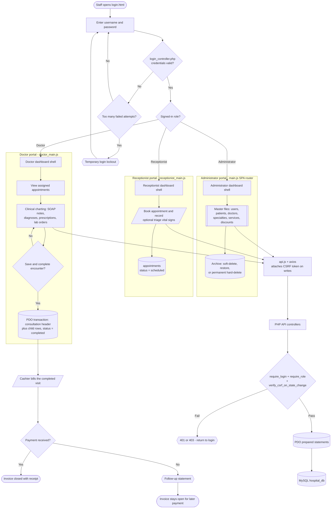

# System Flow

A whole-project flowchart: from staff login, through all three portals, across the patient journey, and down to the shared backend pipeline that every screen uses. The detailed invoice path lives in [[Billing Workflow]]; the file-level structure lives in [[Architecture]].

Obsidian renders the diagram below natively (Mermaid) in Reading view — no plugin needed.

## Shape legend
- **Stadium `([ ])`** — start and end states.
- **Parallelogram `[/ /]`** — a person-facing action.
- **Rectangle `[ ]`** — a processing step or screen.
- **Cylinder `[( )]`** — a database table or transaction.
- **Diamond `{ }`** — a yes/no decision.
- **Subroutine `[[ ]]`** — a grouped set of screens.
- **Hexagon `{{ }}`** — a system alert or notice.

## How to read it
1. **Login & roles** — `login.html` checks credentials through `api/auth_controller.php`, applies failed-attempt rate limiting, then routes the user by role: Administrator, Doctor, or Receptionist.
2. **Administrator portal** — maintains the master files ([[Manage Users]], [[Manage Patients]], [[Manage Doctors]], [[Manage Specialties]], [[Manage Services]], [[Manage Discounts]]) and the [[Manage Archive]] recycle bin (soft-delete lifecycle in [[Database Schema]]).
3. **Receptionist portal** — books the appointment and optionally records triage vital signs ([[Receptionist Appointments]]).
4. **Doctor portal** — views assigned appointments, charts the encounter ([[Doctor Consultation]]), and saves it as one all-or-nothing transaction that sets the appointment to `completed`.
5. **Billing** — the completed visit becomes an invoice, then payment decides whether it closes or stays open (full flow in [[Billing Workflow]]).
6. **Shared pipeline** — every screen action travels the same path: JS module → `api.js` (adds the CSRF token) → PHP controller → login/role/CSRF guard → PDO prepared statements → MySQL. Failed guards return `401`/`403` and send the user back to login (details in [[Security]]).
