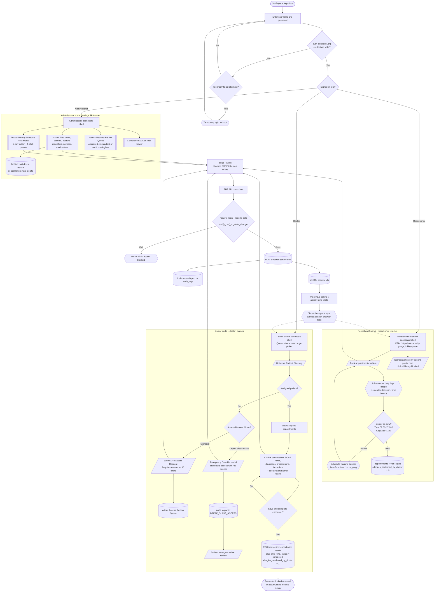

# System Flow

A whole-project flowchart: from staff login, through all three portals, across the patient journey, and down to the shared backend pipeline that every screen uses. The file-level structure lives in [[Architecture]].

Obsidian renders the diagram below natively (Mermaid) in Reading view — no plugin needed.

## Shape legend
- **Stadium `([ ])`** — start and end states.
- **Parallelogram `[/ /]`** — a person-facing action.
- **Rectangle `[ ]`** — a processing step or screen.
- **Cylinder `[( )]`** — a database table or transaction.
- **Diamond `{ }`** — a yes/no decision.
- **Subroutine `[[ ]]`** — a grouped set of screens.
- **Hexagon `{{ }}`** — a system alert or notice.
- **Dashed line `-.->`** — real-time asynchronous browser event broadcast.

## How to read it
1. **Login & roles** — `login.html` checks credentials through `api/auth_controller.php`, applies failed-attempt rate limiting, then routes the user by role: Administrator, Doctor, or Receptionist. Session probe (`action=check`) prevents red console errors.
2. **Administrator portal** — maintains master files ([[Manage Users]], [[Manage Patients]], [[Manage Doctors]], [[Manage Specialties]], [[Manage Services]]), manages weekly doctor schedules and presets (`doctor_schedules`), reviews and approves standard record access requests, inspects the compliance audit log, and manages the [[Manage Archive]] recycle bin (soft-delete lifecycle in [[Database Schema]]).
3. **Receptionist portal** — lands directly on the Receptionist Overview dashboard with KPI counters, 10-patient capacity gauge, and lobby queue table. Books appointments with live doctor duty day badges, calendar date `min` bounds, 08:00–17:00 operating time bounds, zero-retype draft preservation, triage vitals, and printable appointment slips ([[Receptionist Appointments]]).
4. **Doctor portal** — accesses daily appointments with date range pickers and stacked vitals, browses the universal patient directory with a two-tier access architecture (standard 24-hr approved request or audited Break-Glass emergency override for unassigned patients), charts clinical encounters ([[Doctor Consultation]]), and saves them in an all-or-nothing transaction that marks the visit `completed` and elevates allergies to `Doctor Confirmed`. Completed visits are locked against post-consultation editing, allowing only dated addenda.
5. **Shared pipeline & live sync** — every write action travels through `api.js` (attaching the CSRF token) → PHP controller → auth, permission, and schedule guards → PDO prepared statements. Critical actions (break-glass overrides, schedule edits, demographic changes, allergy confirmations) are permanently recorded in `audit_logs` via `includes/audit.php`. Behind the scenes, `live-sync.js` polls `sync_state` and fires `cprms:sync` custom events to auto-refresh queues in real-time across all open browser tabs.
